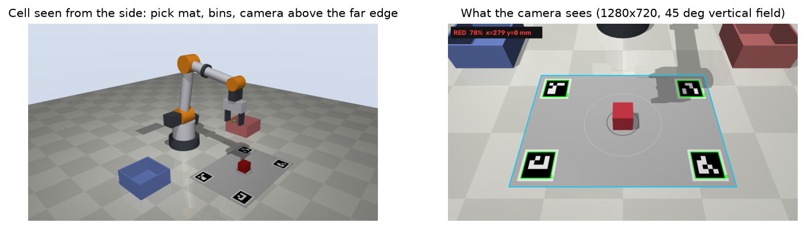
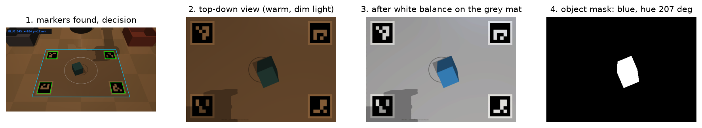
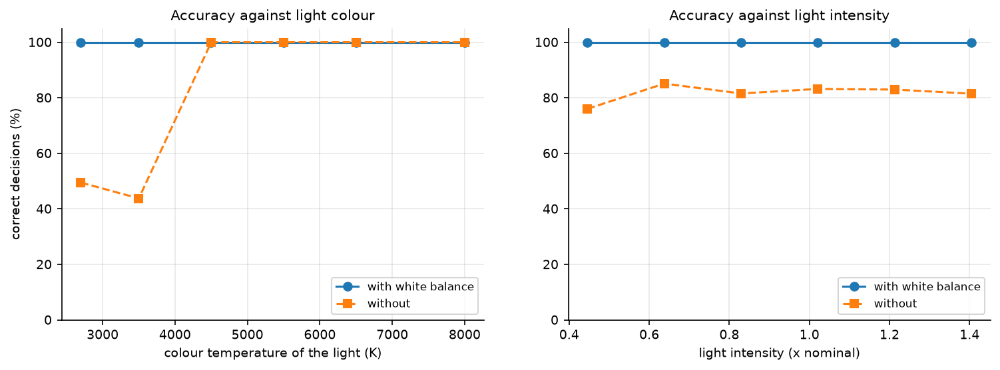
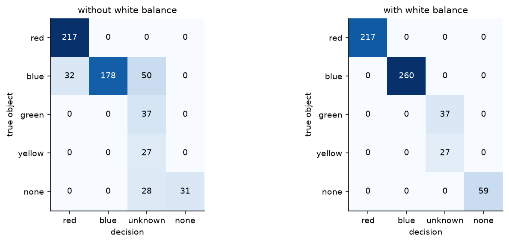
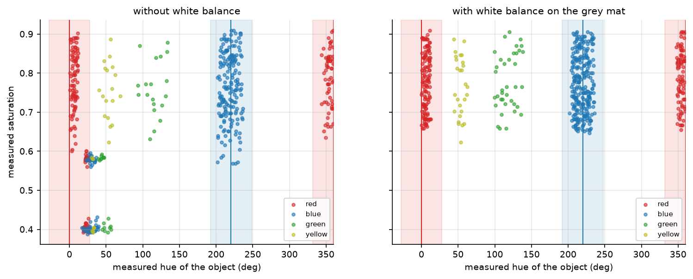
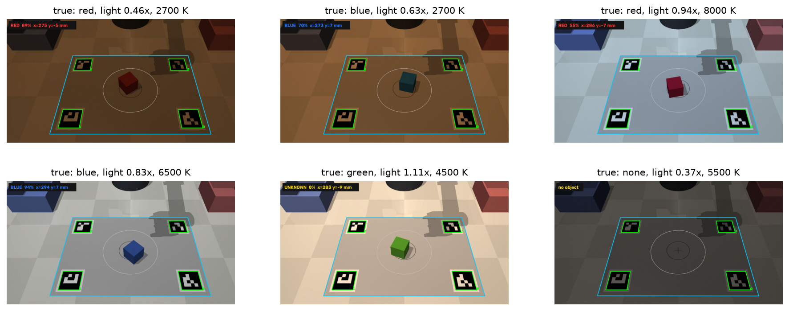
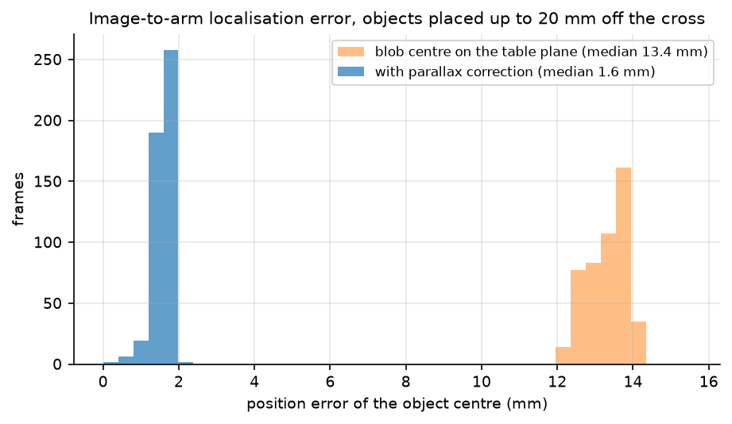

# E6 - Computer vision: colour detection and image-to-arm calibration

> **Where the test script is.** The simulated-camera test (`experiments/e6_vision.py`) needs the MuJoCo cell of the
> simulation project, so it lives in https://github.com/Moetez-Fradi/CV-robotic-arm. This folder has the vision code
> it tests, and this report with its figures.

**Scripts:** `vision/detector.py` (the code the laptop runs), `experiments/e6_vision.py` (this test)

> **Status of the evidence.** The frames are rendered by the physics simulator from a virtual
> 1280x720 camera, with sensor noise and JPEG compression added, under lighting that varies in
> intensity and colour. They test the algorithm, not the real webcam: the same script must be
> repeated with real frames in the build phase (`python -m vision.calibrate` then `vision.live`).

## Setup

* **Camera:** fixed USB webcam 300 mm above the table and 220 mm beyond the
  pick spot, on the side away from the arm, looking down at the pick spot (54 deg below horizontal).
  The arm never passes between the camera and the object while it waits at the ready pose.
* **Pick mat:** A4 sheet printed in neutral grey with four ArUco markers (40 mm, IDs 0-3) at the corners and a
  cross at the pick spot. It is the calibration target and the white-balance reference at the same time.
* **Pipeline** (`vision/detector.py`): markers -> homography and camera pose -> top-down view at 2 px/mm ->
  white balance on the bare mat -> saturated blob within 60 mm of the cross -> hue -> nearest calibrated colour
  (accepted within 28 deg, otherwise "unknown") -> blob centre -> camera ray -> object centre in arm mm.

## Colour calibration

Six frames per colour at nominal light, object on the cross. Stored in `vision/calib_sim.json`.

| Colour | Hue centroid (deg) | Saturation | Frames |
|---|---|---|---|
| red | 0.0 | 0.78 | 6 |
| blue | 220.1 | 0.78 | 6 |

## Test campaign

600 frames, each with a random object (38 % red, 38 % blue, 6 % green, 6 % yellow, 12 % empty mat), placed up to
20 mm off the cross with a random rotation of up to 45 deg, light intensity 0.35x to 1.5x nominal,
light colour from 2700 K (warm lamp) to 8000 K (cold daylight), noise 3 grey levels, JPEG quality 80.
Expected decision: red -> red bin, blue -> blue bin, green or yellow -> "unknown" (no bin), empty -> "none".

| Result | Our pipeline | Same pipeline without white balance |
|---|---|---|
| Correct decisions, all classes | 100.0% | 81.7% |
| Red or blue object sent to the wrong bin | 0 / 477 | 32 / 477 |
| Green or yellow object sent to a bin | 0 | 0 |
| Object present but not seen | 0 | 0 |
| Empty mat reported as an object | 0 | 28 |

Of the red and blue objects, 0 were rejected as "unknown" instead of sorted. "Unknown" is a safe outcome: the
sequencer reads again or leaves the object.

The scatter shows why the white balance matters: under warm or cold light the raw hue of the same object drifts by tens of
degrees, and red and yellow, or blue and green, move into each other's band. Dividing by the grey mat brings every object back
next to its calibrated centroid.

## Image-to-arm calibration

* Markers found in 600 / 600 frames; median reprojection error of the marker corners **0.69 px**.
* Object centre error over the red and blue objects: median **1.6 mm**, 95 % below **1.8 mm**,
  worst 2.2 mm. Without the parallax correction (blob centre taken on the table plane) the median is
  13.4 mm: the camera sees the top and sides of a 30 mm object, not its footprint.

## Timing

Median 102 ms per frame, 95 % below 130 ms, on the team laptop in Python
(337 ms per test including rendering). One decision is needed per object, so this is not a constraint.

## What this decides

1. A fixed webcam on the far side of the pick spot, with the printed grey mat under the object.
2. White balance on the mat, then classification by hue with a rejection band: lighting changes do not send objects to the wrong bin,
   and unknown colours are refused instead of guessed.
3. Pose from the four markers: the camera can be bumped or re-mounted and only needs the mat in view; no manual re-calibration.
4. The measured object position can correct the grasp when an object is placed off the cross.

## Limits

* Simulated frames: real webcam auto-exposure, lens distortion, motion blur and specular highlights on glossy objects are not
  reproduced. Lens distortion is handled by the intrinsic calibration (`vision.calibrate intrinsics`).
* Object colours are drawn from fixed hue ranges; the real objects' colours are unknown until the kit is delivered and must be
  calibrated with `vision.calibrate colours`.
* Shadows of the arm only appear in the ready pose used here.

---
*Generated 2026-11-16 by the script named in the header.*
